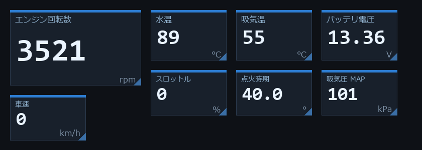

# NCEC ROM Tool — Manual (English edition)

This is the English edition of the manual. It is a condensed version of the Japanese chapters
(the Japanese edition, `map_analysis_JA.html`, is the complete one). Addresses and values apply to
CAL ID **LFG7EG** (2005 Mazda MX-5 NC, chassis NCEC, LF-VE, Denso 279700-4073, Renesas SH7058).

> **Safety.** No warranty; use at your own risk. Changing ignition, fuel, limiters or the
> electronic throttle can damage the engine or make the car undriveable. Keep the original read-out
> of every ECU in `rom_data/`. Do not cut power while flashing. Defeating emissions monitoring or
> suppressing emissions DTCs is out of scope for this project.

## 1. Setup (Windows)

1. **Requirements**: Windows 10/11, Python 3.10+ (developed on 3.14), a gs_usb / candleLight CAN
   adapter (DSD TECH SH-C30L), CAN wiring at 500 kbps (request `0x7E0`, response `0x7E8`), a stable
   power supply for a bench ECU.
2. **Install dependencies**: double-click `setup_install.bat` (or `pip install -r requirements.txt`).
3. **Adapter driver**: with [Zadig](https://zadig.akeo.ie), list all devices, select
   "gs_usb" / "candleLight" and install the **WinUSB** driver. Check with `python tools/probe.py`.
4. **Files you supply** (not distributed publicly): the LibreTuner `mx5_nc` definitions in
   `defs/libretuner/` (`main.json` + `LFG7EG.json`), your ROM dump in `rom_data/`, and the NC1 SBL
   (`Decryption_sbl/sbl_nc1_flash_0x2000.bin`, 0x1800 bytes) if you want to flash.
5. **Start**: double-click `NCEC_ROM_Editor.bat` (`NCEC_ROM_Editor_quiet.bat` hides the console).
   On start the editor opens `rom_data/ecu_readout_yahooauction.bin` if it exists.

Folder layout after v2.71:

| Path | Content |
|---|---|
| `ncec_editor.py`, `ncec_dashboard.py`, `ncec_chart.py` | Editor, dashboard, log chart |
| `ncecu/` | Library: definitions, ROM access, checksum, CAN / ISO-TP, flashing, patches |
| `tools/` | Command-line tools (flash, patches, probes, docs/manual builders) |
| `defs/libretuner/` | Map definitions (922 tables) |
| `rom_data/` | ROM images (read-outs and the ROM in use) |
| `Decryption_sbl/` | SBL used for flashing |
| `docs/` | This manual (`map_analysis.html` / `map_analysis_JA.html`) and its sources |
| `logs/` | Recorded live logs |

## 2. Faster flashing with WSL2 + socketcan

On Windows the gs_usb driver path costs about 1.3 ms of USB round trip per CAN frame, so a full
flash takes about 273 s. Under WSL2 the Linux kernel sends the frames (socketcan) and the same flash
takes **about 58 s** (measured). Setup, once per PC:

1. `wsl --install -d Ubuntu-24.04` (admin PowerShell; `wsl --update` if WSL is already installed).
2. `winget install usbipd` (optional; step 3 installs it if missing).
3. With the adapter plugged in, right-click `tools\setup_ncec_wsl.ps1` → *Run with PowerShell*.
   It binds the adapter (VID:PID `1d50:606f`), installs `python3-tk` / `python3-can` in WSL and
   installs the `can0` start-up helper.
4. From then on, double-click **`NCEC_Editor_WSL.bat`**. It attaches the adapter to WSL, brings
   `can0` up at 500 kbps and starts the editor with `NCEC_CAN=socketcan:can0`.

If communication stops: **Settings → CAN connection → Reconnect**. If the dialog reports that the
USB/IP link is gone (this happens when Wi-Fi reconnects or the PC resumes from sleep), close the
editor, run `wsl --shutdown` in PowerShell and start `NCEC_Editor_WSL.bat` again. Turn Wi-Fi off
and keep the PC awake while flashing.

## 3. Editor basics

- **Layout**: toolbar (open / save / read ECU / compare / Live / record / replay / write ECU), a
  tree of tables by category on the left, the selected map on the right with axis labels, a
  description area, and a status line (file, definition, checksum state).
- **Editing**: click a cell, type a value, press Enter. **Save** recalculates all checksums
  (table at `0xFF650`–`0xFF7FC`). Nothing is written to the ECU until you press **ECU Write**.
- **Search**: type part of a table or category name (Japanese or English). Since v2.71 a query
  starting with `0x` searches by **address**:
  - `0xD6CDC` — the table (or axis) at that address; an address in the middle of a table also matches.
  - `0xD6C` — while typing, every table whose address starts with those digits.
  - `0xFFFF6D5C` — a RAM address lists the tables that use that variable as an axis input
    (e.g. RPM `0xFFFF6D5C`, load `0xFFFF6EC8`, coolant `0xFFFF6CC8`). The match uses this ROM's real
    addresses, found from the ROM code (`ncecu/axis_ram.py`); the number at the end of an axis name
    (e.g. `RPM_6DD8`) is a RAM address of another ROM used by LibreTuner and is not used.
  - The description area shows the axis input RAM of the open table when it is known.
- **Language**: the JA / EN button. **Help** shows the built-in help and opens this manual.

### 3.1 Split view, separate windows and paired tables (v2.80)

- **View** menu: single (Ctrl+1), 2 side by side (Ctrl+2), 2 stacked (Ctrl+3), 4 = 2x2 (Ctrl+4),
  3 = 1 left + 2 right (Ctrl+5). Drag the borders to resize. A table picked in the tree opens in the
  **active pane** (blue frame); click a pane or use Ctrl+Tab to change it, or right-click a tree item
  and choose the pane. Axis headers stay fixed while the table scrolls. Ctrl+wheel / Ctrl++ / Ctrl+- zoom.
- Pane buttons: ⇔ = show the paired control/monitor table next to it (Ctrl+P), ⧉ = open in a separate,
  freely placed window (Ctrl+Shift+D), × = clear the pane.
- **Paired tables** (23 control/monitor Data Integrity pairs): the line under the pane title says
  whether all cells are equal; differing cells get a red corner. With **View → Paired editing** (on by
  default) every cell or axis edit is written to both copies; undo reverts both. "Copy selection to the
  paired table" fixes an existing mismatch.
- The layout, the tables and zoom of each pane, separate windows and the window size/position of the
  editor and the dashboard are restored on the next start (`ui_settings.json`).

### 3.2 Editing operations and undo (v2.80)

- Select with click / drag / Shift+click / Shift+arrows; click an axis header for a whole row or
  column, the corner (or Ctrl+A) for everything. Typing a number with several cells selected sets them all.
- Operations on the selection: + / − (small step), PgUp / PgDn (large step), = set, A add, * change by %,
  M multiply, H / V interpolate along the axis values, B interpolate from the four corners, S smooth,
  Ctrl+D / Ctrl+R fill down / right, Ctrl+C / Ctrl+V (tab-separated, works with spreadsheets),
  Ctrl+Shift+R revert to the saved values, Space jump to the live ● cell. I sets the per-table step.
- Undo Ctrl+Z / redo Ctrl+Y cover cell and axis edits and patches (300 steps). Cells changed since
  the last save get an orange corner. Right-click a table for all of these with their keys.
  Under WSL (WSLg) the right-click menu is drawn inside the editor window (v2.81), because WSLg shows a separate
  menu window late (it flashes on an outside click and lingers about 1 s); Windows keeps the native menu.
- To type a negative value, start editing with Enter or F2 first (a bare "−" means decrease).

### 3.3 Keyboard shortcuts (v2.80)

**Settings → Keyboard shortcuts…** lists every action with its keys; assign several keys per action,
remove them, or reset. Table actions only work while the table has focus, so typing in the search box is
not disturbed. Navigation keys and digits are reserved; ECU flashing has no shortcut on purpose.
Defaults: Ctrl+O/S/Shift+S file, Ctrl+Z/Y undo/redo, Ctrl+F search, Ctrl+T tree, Ctrl+E table,
Ctrl+PgDn/PgUp next/previous table, F5 Live, F6 dashboard, F8 record, F9 log chart, F1 help.

## 4. Live monitoring and map following

**Live ▶** polls OBD-II Mode 01 PIDs (up to 6 PIDs per request) and draws the current operating
point as a red ● on the open map.

- **Signals used for the ●**: RPM (`0x0C`), engine load, coolant temperature, intake temperature,
  pedal position, throttle position.
- **Load is absolute load (PID `0x43`)**, not calculated load (PID `0x04`). The map load axis
  (`LOAD_6F44`; input RAM `0xFFFF6EC8` in this ROM) matches PID `0x43`: in the logs the knock-listen load thresholds
  (enter at 0.40, leave at 0.353) coincide with PID `0x43` crossing 40 % / 36 %, while PID `0x04`
  read 52 % / 44 % at the same moments. Up to v2.70 both PIDs fed the same "load" role, so the ●
  jumped to the wrong row about once a second; fixed in v2.71.
- **Pedal position** for pedal-axis maps is normalised from the raw sensor value of PID `0x49`
  (about 31.4 % released, 72.3 % floored) to 0–100 %. This is an approximation derived from
  10,800 logged samples against the ECU-internal pedal value.
- **Intervals** (Settings → Live PID intervals): every signal uses the same list —
  **Every cycle / 0.1 s / 0.2 s / 0.5 s / 1 s / 2 s / 5 s / 10 s / Ignore**. *Ignore* means the
  signal is not read. Keep at most six signals on "every cycle" so one request per cycle is enough.
- **Defaults**: every cycle = RPM, absolute load, throttle, pedal, timing, MAP. MAF and measured
  AFR at 0.2 s (slow items ride along in the same request). **Duplicates are ignored by default**:
  calculated load (`0x04`), pedal sensor E (`0x4A`), brake switch 2.
- **Map following is protected**: signals that are axes of the open map are read even if set to
  Ignore or to a slow interval.
- **Live RAM budget**: Mode 23 reads cost one round trip per memory block, so at most two blocks are
  read per cycle, most-overdue first. PID timing stays constant; RAM channels become best-effort.

Scheduler simulation (request counts are exact; the time per request is an assumption and **was not
measured on hardware**): PID requests per cycle drop from 2.0 to about 1.2; with six RAM channels
the cycle rate improves by roughly 1.5×.

## 5. Dashboard, logging, replay, chart



- **Dashboard**: tiles in number / bar / gauge / graph mode. Right-click a tile for display mode,
  smooth update, update interval (same list as above), colour, scale, alarm value. Since v2.80 the
  window opens at its last size and position. Under WSL (v2.81) the menu is drawn inside the window:
  "display mode" and "update interval" fold out when clicked, and long lists (Add item) use columns.
- **Record ●** writes `logs/livelog_*.jsonl`; **Replay** plays a log back (the ● and the dashboard
  move). **Settings → Log analysis chart** stacks channels of a log as time series.

## 6. Live RAM (Mode 23) and knock

The ECU only serves standard PIDs. Its ReadMemoryByAddress handler (`23 <addr:4> <size:2>` →
`63 <data>`) already allows RAM `0xFFFF0000`–`0xFFFFE000`, but only in the programming session
after authentication. Reading RAM live in the default session needs three bytes changed in the ROM
by the user (`0x84C04` `00→10`, `0x84C07` `06→0F`, `0x7F734` `8F17→0009`) plus a checksum
recalculation. This removes the authentication for reads, so anyone on the bus can read the ECU;
the tool documents the change but does not generate it. Power-cycle the +12 V line after flashing.

| Channel | Address | Type | Meaning |
|---|---|---|---|
| Clutch switch | `0xFFFF7100` | u8 | 0 released / 1 pressed (found on the car with `tools/ram_diff.py`) |
| Brake switch | `0xFFFF70EC` | u8 | 0 / 1 (`0xFFFF70EE` is the redundant second switch; ignored by default) |
| Decel status | `0xFFFF6FCC` | u8 | 0 driving / 1 coasting, neutral, idle |
| Gate APP | `0xFFFF56C8` | f32 % | Pedal value the flat-shift gate reads |
| Injector pulse width | `0xFFFF7380` | f32 ms | 0 ms during decel fuel cut; duty % is derived |
| Exhaust temperature (estimate) | `0xFFFF777C` | f32 °C | Catalyst model, no real sensor |
| **Knock level** | `0xFFFF4E20` | f32 | Knock sensor level per combustion event (internal scale) |
| **KR (knock retard)** | `0xFFFF7C44` | f32 ° | 0 = none; steps to 1.7° on a knock event, then decays |

**Knock findings (2026-11-14).** Knock control works and three KR events are in the logs.

- The sensor is analogue: per cylinder event the ECU computes a level (`0xFFFF4E20`) and compares it
  with an adaptive threshold (`0xFFFF4E58`). The 0/1 flag `0xFFFF4E14` (mirror `0xFFFF7E89`) is only
  the result of that comparison.
- `0xFFFF7C44` is the real KR: +1.7° per event (`0xBBCAC`), −0.17° per event while listening
  (`0xBBF98`), −0.3515° per event below 40 % load (`0xBC0FC`), maximum 8° (`0xBBD20`). The logged
  values match these constants exactly.
- `0xFFFF7C3A`, formerly labelled "knock count", counts combustion events since engine start and
  saturates at 255. A constant 255 is normal.
- Knock is only evaluated from 1000 to 5250 rpm and above 40 % load.
- Not established: how close wide-open throttle runs are to the threshold. Log `0xFFFF4E20` and
  `0xFFFF4E58` together to see the margin.

## 7. Tuning basics

- Most maps are RPM × load. "Load" is cylinder air charge; in OBD terms it is absolute load
  (PID `0x43`).
- RPM axes end at 7000 rpm; above that the 7000 column is held. The rev limit is a fuel cut.
- Change one thing at a time, log before and after, and keep the previous ROM.
- Change timing in steps of 1–2° while watching KR. High load with lean mixture and too much
  advance is the dangerous combination.
- Tables are often duplicated for the safety monitor ("Data Integrity"). Editing only the control
  copy makes the monitor disagree and can force a fail-safe. Edit both copies to the same values.

## 8. Patches (Settings → Apply patch)

Every patch changes only the ROM in memory, lists what it changed (before → after), refuses
unsupported ROMs and re-checks the result (only the intended addresses and the checksum table may
differ).

### 8.1 Flat shift

Read-only design: nothing is written to RAM or registers. Active only while clutch (`0xFFFF7100`) is
pressed **and** pedal > threshold **and** RPM > threshold **and** speed > minimum. Method 0 retards
the final advance, method 1 skips coil charging (no spark). Calibration at `0xDE300`–`0xDE318`
(defaults: pedal 80 %, 7000 rpm, 10 km/h, retard 20°, method 0). `test_mode = 1` ignores the speed
gate for standstill checks; set it back to 0 before driving. Both methods were confirmed on the car
on 2026-11-01. The stock clutch throttle cut (`0xC53BC`) only works below 2 km/h.

### 8.2 Anti-lag (overrun pops)

The engine is naturally aspirated, so this makes sound only. Fuel burns in the exhaust: it heats
the catalyst and exhaust.

| | Name | DFCO | Active | Retard | Tip-in recovery |
|---|---|---|---|---|---|
| **A** | DFCO off | off | all RPM | deep (~22°) | stock |
| **B** | RPM gate (recommended) | **on** | above the active rpm | 20° | stock |
| **C** | RPM gate + response (new in v2.71) | **on** | above the active rpm | shallow (12°) | fast |
| **D** | Response, DFCO off (the "C" of v2.70 and earlier) | off | all RPM | shallow (12°) | fast |

**Active rpm (B and C)**: 1500–6000 rpm in steps of 100, default 3000. The decel fuel-cut table
`0xCC774` (6 gears × 5 rpm points) is interpolated over its own RPM axis `0xCC748`; the patch moves
the axis breakpoints to `[x0, x1, active, active+1000, x4]` with values
`[cut, cut, cut, keep, keep]`. Below the active rpm the fuel cut works normally (silent); pops fade
in above it and are fully active 1000 rpm higher. With the default 3000 the axis is the stock
`[1000, 2000, 3000, 4000, 5000]`, byte-identical to pattern B of v2.70. The axis is referenced only
by this table's descriptor (`0x93E00`).

Verified by running the ECU's own table look-up (`0x20DC`) in the emulator; **not tested on the car**.

### 8.3 Faster rev-drop

Speeds up the rev-drop on an upshift by engaging decel fuel cut sooner (enter count `0xC477D`,
stock 30) and harder (enlean rates `0xCC774`, `0xCC694`, `0xCC698`, `0xCC6A0`). Fuel side only; the
throttle is not touched. The anti-stall floor `0xC47FC` (2312.5 rpm) and the fuel-restore thresholds
stay stock. Presets off / mild / strong. It uses the same table as the anti-lag patch in the
opposite direction, so use only one of the two in a ROM.

### 8.4 Drive-by-wire throttle 1:1

Raises the pedal maps (pedal → throttle, 18 × 10) towards 1:1 for a cable-like response:
`new = stock × (1 − blend) + pedal × blend`. Control and monitor copies are written together
(1st `0xC7EE4`/`0xF7C90`, 2nd `0xC81B4`/`0xF7F60`, 3rd `0xC8484`/`0xF8230`, 4th–6th
`0xC8754`/`0xF8500`, neutral `0xC8A24`/`0xF87D0`), and the commanded maximum
(`0xC55FC`/`0xF7C24`) is raised by `cap_margin`. The 50 % cap in 2nd gear at low rpm disappears.
Peak power does not change. Not tested on the road.

### 8.5 Idle target — edit the maps directly

The idle-speed patch was removed in v2.71; edit **Idle Speed - Base** in the tree.

| System | Control | Monitor | Stock (8 points, −40…100 °C) |
|---|---|---|---|
| In gear | `0xD6C9C` | `0xF4DEC` | 1150, 1150, 1100, 1000, 850, 800, 720, 720 rpm |
| Not in gear | `0xD6CDC` | `0xF4E2C` | 1750, 1750, 1500, 1250, 1000, 850, 720, 720 rpm |

Always set control and monitor to the same values (with **Paired editing** on, editing one writes both;
see 3.1). Do not touch the slew rate (`0xD6AB8` family):
the monitor protects it, and changing it produced DTC P0606 and throttle limp mode on the car.

### 8.6 Cooling-fan temperatures — the values are A/D counts

The coolant thresholds under **Engine Fan Control** are **10-bit A/D counts of the ECT-sensor
voltage, not °C**: volts = value × 5 ÷ 1024, and the temperature follows the
`ECT Scaling - Voltage to ECT` curve (`0xB8258`). The sensor voltage falls as the coolant gets
hotter, so **a larger value means a lower temperature** — raise the value to start the fan earlier.
The flag sets when count ≤ activation value and clears when count > deactivation value, so keep
the activation value below the deactivation value.

| Table (AC Off) | Address | Car stock | Bench original / in-use ROM |
|---|---|---|---|
| Medium, activation | `0xBF9F8` | 96 = ON at 100.1 °C | 125 = ON at 90.0 °C |
| Medium, deactivation | `0xBF9FA` | 103 = OFF at 96.8 °C | 132 = OFF at 87.8 °C |
| High, activation | `0xBF9FC` | 77 = ON at 108.4 °C | 106 = ON at 96.0 °C |
| High, deactivation | `0xBF9FE` | 84 = OFF at 104.6 °C | 113 = OFF at 93.3 °C |

Guide: 85 °C ≈ 143, 90 °C ≈ 125, 95 °C ≈ 109, 100 °C ≈ 96, 105 °C ≈ 84, 110 °C ≈ 74 (one count is
about 0.4 °C). **Opening one of these tables shows the conversion in the description area** (what
temperature the current value switches at, the formula and the guide table); it updates when you
commit a value and warns when the activation value is not below the deactivation value. The six
integer after-cooling enable/disable tables use the same count; speed thresholds (km/h) are plain
values. The timers are counts: the transition delay drops by 1 every 25 ms and the after-cooling
timers every 100 ms (from the OS task periods; the 1 ms tick and the 25 ms sub-task were confirmed on the
car on 2026-11-17 by comparing ECU counters with the 10 ms CAN frames, the fan timing itself was not timed;
the editor shows seconds). A key-on check the same day also confirmed the A/D-to-°C conversion (ECT count
667 = 16.4 °C, the same as the ECU's own coolant value). There is no monitor-side copy of these four thresholds. This comes from the
disassembly (`0x98F9E` compares against RAM `0xFFFF710E`, the ECT A/D count); the temperature at
which the fan actually starts has **not been measured on the car** yet.

## 9. Flashing over CAN

```
10 85, 27 01 / 27 02          programming session, seed / key
B1 00 B2 00                   routine control (precondition)
34 00008000 000FF800          request download (RAM 0x8000, total 0xFF800)
36 <0x400 bytes> ...          SBL (0x1800) then ROM[0x2000:] (0xFE000)
37                            transfer exit
11 01                         ECU reset
```

- The block length must be 0x400. The boot area below `0x2000` is never written.
- The SBL (NC1, 0x1800 bytes) is required and is not distributed publicly.
- CLI: `python tools/flash_writeback.py --sbl <sbl> --rom <rom>` is a dry run; add `--confirm` to
  write. The editor button does the same.
- First flash the unmodified read-out and confirm CAL ID and CVN are unchanged. After flashing an
  edited ROM the CVN changes; that is expected.
- **Measured times**: full flash 273 s on Windows (gs_usb), 58.4 s under WSL2 (socketcan): erase
  about 17 s, ROM transfer 41 s. A full read-out takes about 206 s; the ECU's own transmit pacing
  limits it.
- **If a flash fails**: so far every failure was recovered by power-cycling the ECU and flashing
  again over CAN. This works because the boot area and CAN handlers in block 0 are never written.
- Flash endurance is specified at a minimum of 100 cycles. Collect changes before writing.

## 10. ECU reference

- **MCU**: Renesas SH7058 (SH-2E with FPU, big-endian). Flash `0x00000`–`0xFFFFF` (1 MB), RAM
  `0xFFFF0000`–`0xFFFFBFFF`, peripheral registers from `0xFFFFC000`.
- **Flash blocks**: EB0–EB7 4 KB each (`0x00000`–`0x07FFF`), EB8 96 KB (`0x08000`–`0x1FFFF`),
  EB9–EB15 128 KB each (`0x20000`–`0xFFFFF`).
- **Protocol**: KWP2000-style services on CAN 500 kbps. OBD-II Mode 01 / 03 / 04 / 07 / 09;
  `10 81`, `10 85`, `3E 01`; security access `27 01` / `27 02` with a 3-byte seed;
  ReadMemoryByAddress `23` (4-byte address, 2-byte size, no format byte, up to 0x400 bytes).
- **Checksum**: table at `0xFF650`–`0xFF7FC`, 12-byte entries, 35 regions; corrected on save.
- **Learned values** (idle, throttle) live in battery-backed RAM and survive a reflash; relearning
  is needed only after the ECU loses battery power.
- **Boot mode** (serial, via FWE / MD pins) erases the whole flash on entry. It cannot read a ROM,
  but it is the last-resort recovery if the boot block is ever damaged; it needs board access and a
  complete 1 MB backup.

## 11. Definition audit and unit fixes

- Some tables in the definition have wrong dimensions or point at unused areas. The editor corrects
  the dimensions it can verify from the ECU's table descriptors and warns on the rest.
- The definition carries no units, so the editor infers them. Unit rules were corrected for 22
  categories (about 95 tables) and one axis label in `ncecu/i18n.py`; the bilingual list is in the appendix.
- Two control-side idle tables missing from the definition were added in v2.70.
